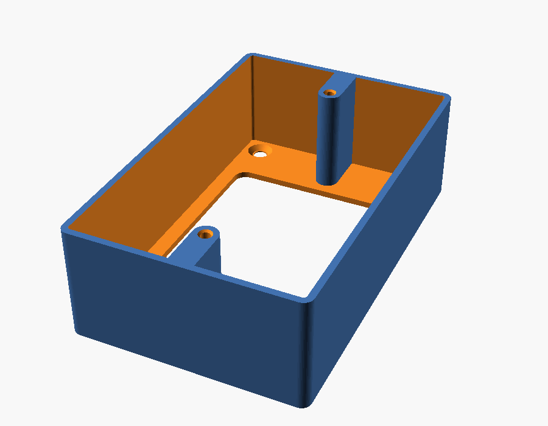

# C2000 HDMI Wallplate Mounting Block

A parametric OpenSCAD surface mounting block for C2000-style (Clipsal 2000 series / AU-NZ standard, 84 mm screw centres) wall plates. It's designed for an HDMI wallplate whose cable comes out of the wall behind it.

## Features
- The walls and back are thin (2 mm) for as much space inside as possible: about 68 × 110 × 33 mm at the default 35 mm depth.
- The two posts for the plate screws are joined to the end walls, so the middle of the box stays clear.
- A large 58 × 70 mm hole in the back lets the cable come straight out of the wall.
- Four countersunk holes in the inside corners screw the block to a solid wall.
- Optional cable slots can be added in the top, bottom or side walls.
- Built-in checks warn you if the back hole would cut into the screw posts or the fixing holes.

## Files
- `c2000_mounting_block.scad`: the parametric model. Open it in OpenSCAD and use the Customizer to change it.
- `c2000_mounting_block.stl`: ready to print with the default settings (35 mm deep).

## Key parameters
| Parameter | Default | Notes |
|---|---|---|
| `depth` | 35 | Total depth off the wall |
| `outer_h` / `outer_w` | 115 / 73 | Outside size. Measure your plate! |
| `base` | 2.0 | Back thickness |
| `back_hole` | [58, 70] | Size of the cable hole in the back |
| `screw_centres` | 84 | Distance between the plate screws |
| `screw_pilot_d` | 2.9 | 3.5 mm self-tapping screws; use about 4–4.6 for heat-set inserts |
| `fix_d` / `fix_head_d` | 4.5 / 8.5 | Holes for #8 / 4 mm wood screws |

## Printing
Print it with the open face up. It doesn't need supports. PETG is recommended, with 3–4 perimeters so the screw posts are strong.
